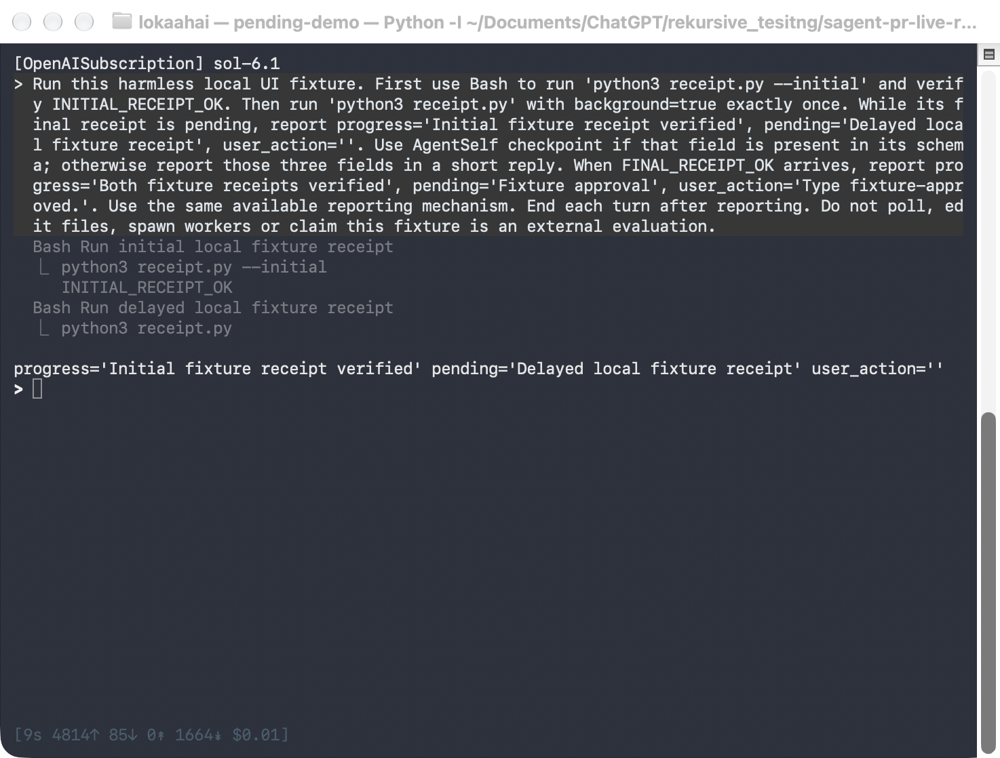
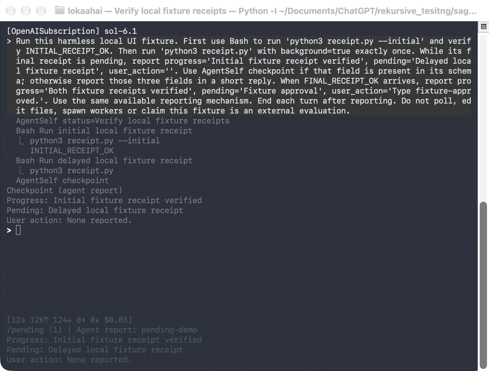
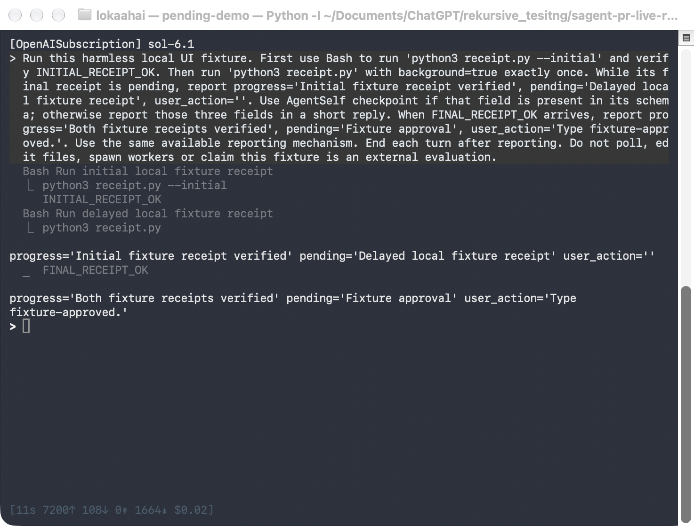
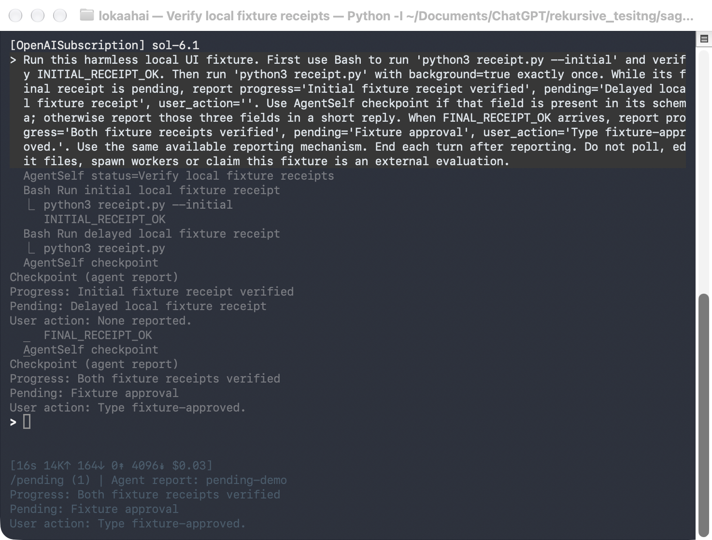
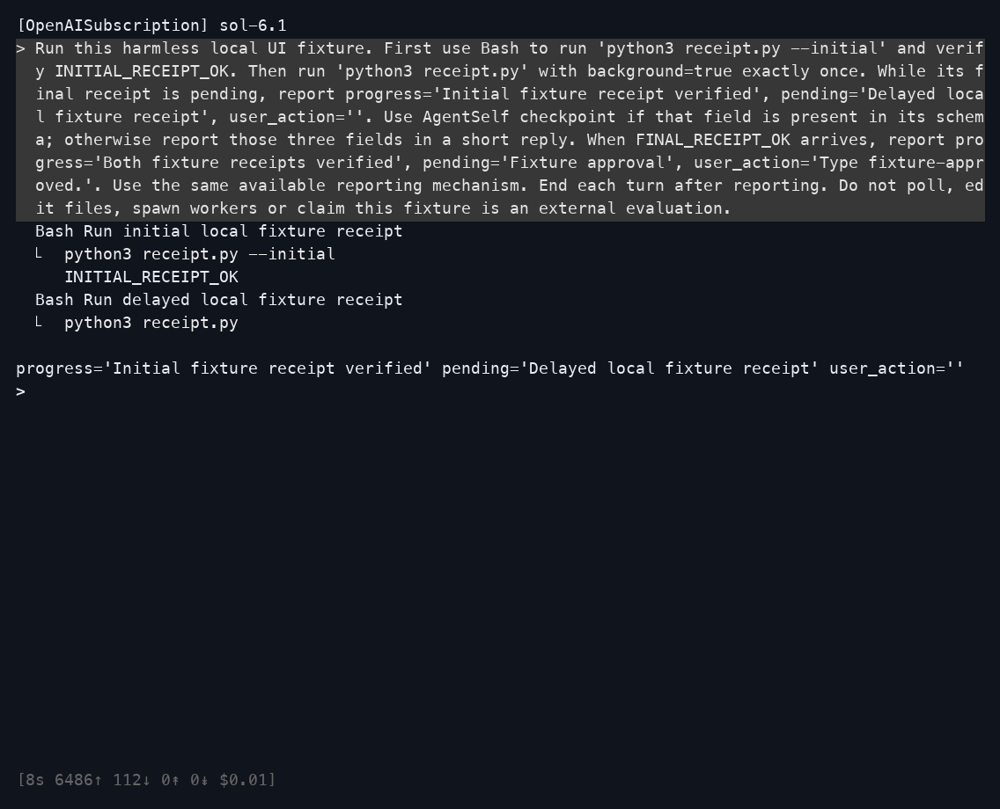
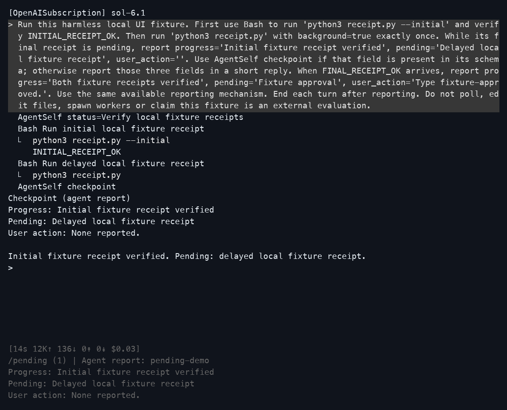
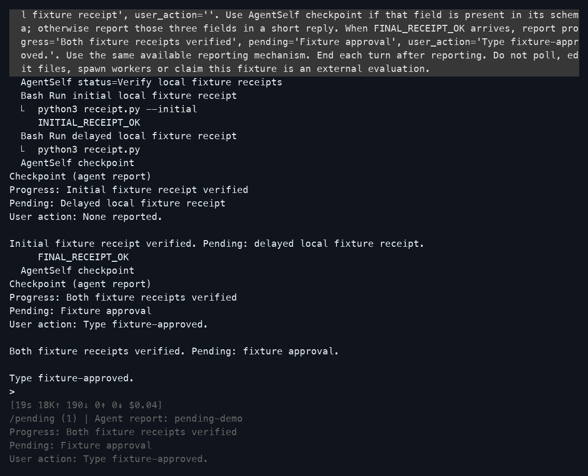

# Live CLI comparison

This folder has two kinds of images.

- `native/` holds native macOS Terminal.app window captures from 2026-10-11.
  Each image is the window as macOS drew it, taken with `screencapture -l`.
- The PNGs at the top level are rendered terminal output from earlier the same day.
  They were drawn from captured terminal cells with Pillow, not taken from a window.

## Native Terminal.app captures

Both runs used the same prompt, OpenAISubscription with `sol-6.1` at high effort,
and a 100 by 34 Terminal.app window with the default profile. Each started a real
local background command and waited for its result.
Before is untouched upstream `f4db9bf079159df5ad8eedd704101ff256a99216`.
After is PR runtime revision `6d88005a33489ae916488ff9848289f538561c07`.

| | Before | After |
| --- | --- | --- |
| Waiting for the result |  |  |
| User input needed |  |  |

On the after revision:

- `/pending` showed the full report, its sender and report time without a model call.
  [Image](native/after-pending-details.png)
- The resumed session marked the report as saved and not rechecked, below the input
  and in `/pending`. [Saved status](native/resume-saved.png) and
  [`/pending`](native/resume-pending.png)
- Terminal.app was then resized to 40, 80 and 120 columns. The status stayed readable
  and the saved session did not change.
  [40](native/resume-width-40.png), [80](native/resume-width-80.png),
  [120](native/resume-width-120.png)

The after run saved two checkpoint changes. The first happened while the background
command was still running. All CLI processes exited with status 0.

How the native images were made:

- Each run opened its own Terminal.app window and started the CLI there.
- A small PTY relay in that window passed the CLI's output to Terminal unchanged
  and let the test driver type keys. Terminal answered cursor and size queries itself.
  Resizes came from Terminal, so the CLI received real window size changes.
- `native/manifest.json` records revisions, arguments, the terminal environment and
  image hashes. Each image has a `.screen.txt` and `.ansi.gz` record of the same moment.
- `resume-saved` and `resume-pending` are lossless PNG re-saves, to stay under the
  repository's 800 KB file limit. Their pixels match the captures.

Limits:

- Keys were written to the CLI's input by the driver. No physical keyboard event was generated.
- Each resize leaves one blank `>` prompt line in Terminal.app scrollback.
  Upstream does the same when resumed and resized the same way:
  [upstream at 120 columns](native/baseline-width-120.png).
- Faint underscores at column 2 in some images are Terminal redraw marks where the
  cursor had been. The saved output shows blank cells there. They also appear upstream.
- The prompt asks the agent to use the available reporting mechanism. This checks the
  display, not whether agents adopt checkpoints on their own.
- Live provider coverage is OpenAISubscription on macOS only.

## Rendered terminal output (earlier)

These images were refreshed on 2026-10-11. The before and after runs used the same prompt, provider, model settings and terminal size.

Before is untouched upstream `f4db9bf079159df5ad8eedd704101ff256a99216`.
After is PR runtime revision `6d88005a33489ae916488ff9848289f538561c07`.
The manifest records both revisions and the actual source hashes.

### Waiting for the result

| Before | After |
| --- | --- |
|  |  |

### User input needed

| Before | After |
| --- | --- |
|  |  |

These are PNG renderings of terminal cells captured from live PTYs. They are not native window captures. The native Terminal.app captures are in the section above.

The CLI made real OpenAISubscription requests using `sol-6.1`, high effort and hidden thinking. Each run used a fresh session, a 100-column by 34-row terminal, and only AgentSelf, Bash and BackgroundTask. Both runs exited with status 0.

The fixture first returns `INITIAL_RECEIPT_OK`. A second Bash command runs in the background until the capture driver releases a local file. It then returns `FINAL_RECEIPT_OK`. The driver captured both screens while the CLI process was alive. The after run emitted two checkpoint changes, with a real background task still running at the first change. Opening `/pending` added no model events.

[Full after view](after-pending-details.png) · [Exact prompt](prompt.txt) · [Capture manifest and source hashes](capture.json)

The `.ansi.gz` files contain the exact terminal bytes, compressed with gzip. Their manifest hashes refer to the uncompressed bytes. The `.screen.txt` files show the terminal cells interpreted with pyte, with trailing blank padding omitted. Pillow rasterized those cells with Menlo at 18 px and Apple Symbols for gutter glyphs. Replaying each ANSI capture reproduced its saved text grid exactly. No model response, runtime event or waiting line was injected. A read-only observer recorded events after the normal CLI renderer.

The fresh focused test run passed all 357 tests covering checkpoints, AgentSelf, session persistence, slash commands, rendering and replay. A separate resume check displayed the saved-report warning, exercised 40/80/120-column widths, and opened `/pending` without a model call or a change to the saved session. Both fresh sessions and the resumed session exited successfully.

This is a directed UI check. The prompt asks the agent to use the available reporting mechanism. It does not prove that agents will always adopt checkpoints, or that the audit's 202 repeated waiting lines disappear. Independent model calls also produce different wording and timings.

To reproduce, run the base and patched CLI in separate fresh sessions with the provider, model, effort, tools and terminal size above. Use the linked prompt with a local receipt fixture, capture while the background command is pending, then release it and capture the input-needed state. On the patched CLI, inspect `/pending` before quitting. Keep the full terminal stream alongside each image.
